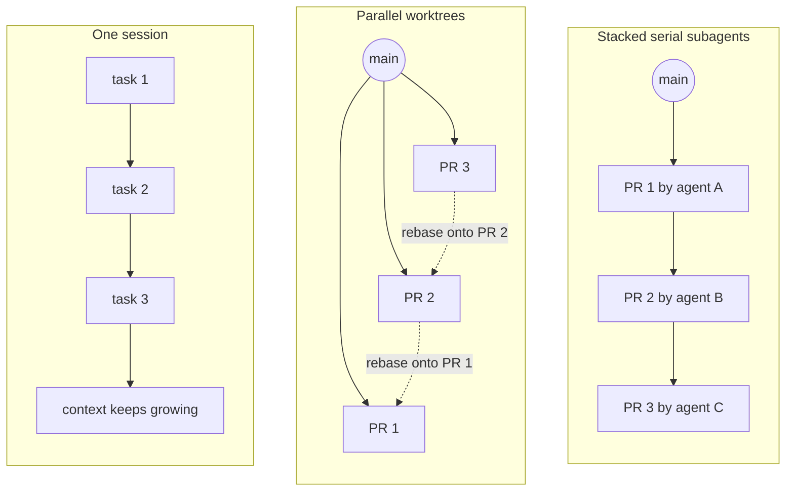
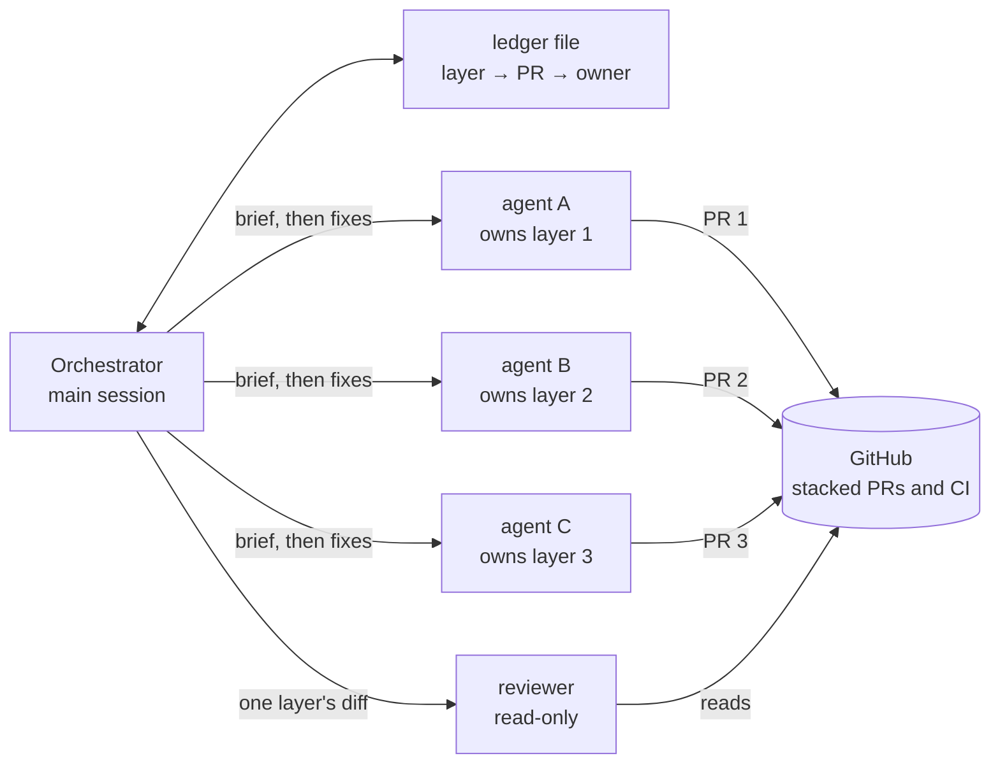
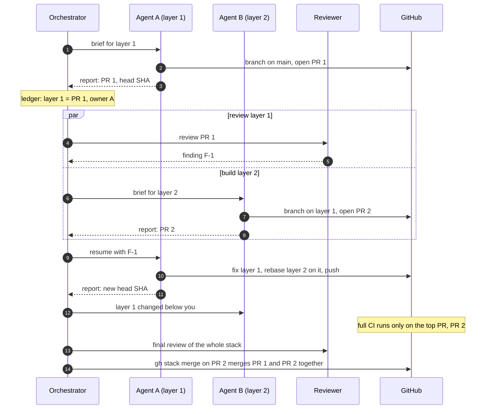
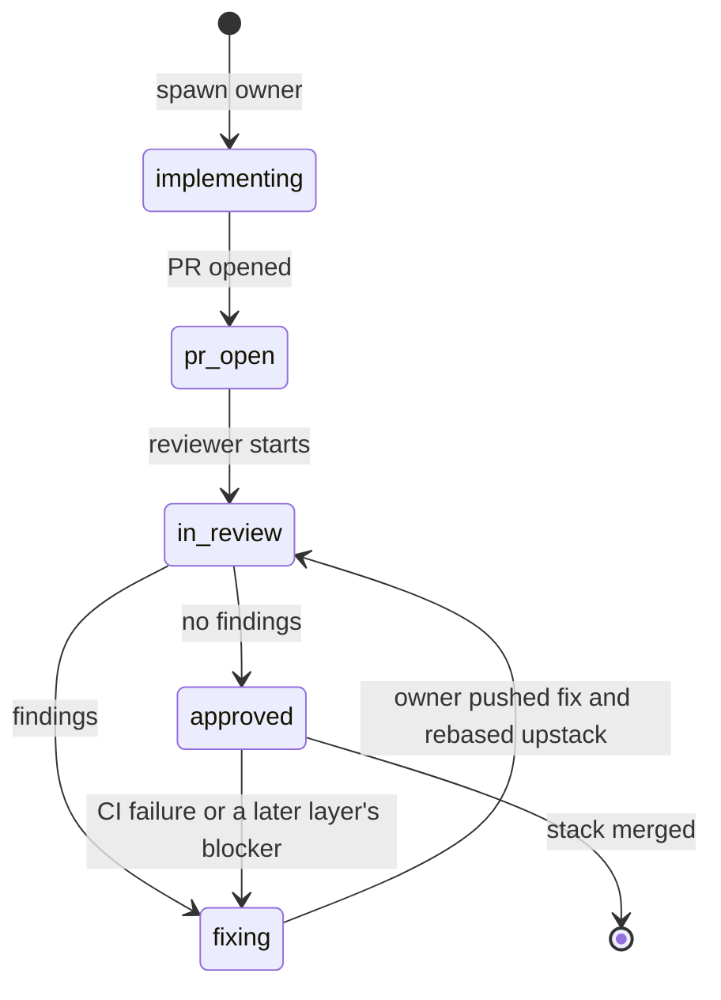

# Stacked PRs with serial subagents

An agent skill for implementing a multi-task plan as a stack of pull requests. The main agent session orchestrates. One subagent at a time builds one layer on top of the previous one and opens its PR, and the subagent that wrote a layer is the one that later changes it. The finished stack is reviewed and merged in one operation.

The skill itself is [`.agents/skills/stacked-pr-subagents/SKILL.md`](.agents/skills/stacked-pr-subagents/SKILL.md). This page explains the strategy behind it.

## The problem

There are two common ways to have a coding agent implement a plan of many tasks, and both waste something.

- **One session does everything.** Every turn re-sends the whole conversation, so each turn costs more than the last. A plan of a dozen tasks can push a session to hundreds of thousands of tokens of context, and the quality of its work drops as that context fills.
- **Parallel subagents in separate worktrees.** Each context stays small, but tasks in a plan usually depend on each other. Parallel branches then conflict, every PR has to be rebased onto the others, and each PR waits on its own CI run before the next one can build on it.

## The strategy

Serial subagents on stacked branches keep the small contexts and drop the rebasing:

- **One writer at a time.** The orchestrator hands one layer at a time to a fresh subagent. That subagent starts from the branch below, so its work never conflicts with a sibling's.
- **One PR per layer, stacked.** Each layer opens a pull request based on the layer below it, using [GitHub stacked pull requests](https://docs.github.com/en/pull-requests/get-started/about-stacked-prs) and the [`gh stack`](https://github.com/github/gh-stack) extension. Reviewers see one layer's diff at a time.
- **Owners stay reachable.** The orchestrator records which subagent owns which PR. A review finding or a CI failure goes back to the owner, which resumes with its context, and its prompt cache while that is still warm, instead of a new agent reading the code again.
- **Nobody waits for CI.** The next layer starts as soon as the previous one is pushed. The full CI suite runs only on the top PR, which contains every layer.
- **One merge.** When every layer is reviewed and the top PR is green, `gh stack merge` lands the whole stack at once.

Despite the subagents, nothing runs in parallel except review and CI: one agent writes at a time, and the layers are built in order.



## Roles



- The **orchestrator** writes no code. It splits the plan into layers, briefs each layer agent, keeps the ledger, and routes every finding to the layer that owns the fix. It reads only reports, the ledger, stack state and CI results, so its own context stays small too.
- A **layer agent** implements one layer, opens its PR with a body that later layers read as their handoff, and then stays available for changes to that layer.
- A **reviewer** reads one layer's diff by git refs, so it can run while the next layer agent is writing.

The ledger is a file next to the code, outside the chat, so it survives the orchestrator's compaction and restarts.

## A run



## Fixing a lower layer

A finding is fixed on the branch of the layer that introduced the problem, never as a patch on top of the stack. The owner commits the fix on its own branch and replays every layer above it with `gh stack rebase --upstack`. Git's `rerere` remembers each conflict resolution, so a conflict resolved once is replayed automatically in the layers above.



Resuming the owner is the default because it already knows the code it wrote. The provider's prompt cache makes this cheaper still while it is warm: about 5 minutes for Claude subagents by default, at least 30 minutes on recent OpenAI models. After that, the owner's transcript is billed again at the full input price, which is still usually cheaper than a new agent reading the code and the PR history again. A fresh agent takes over only when the owner's context is nearly full or its session is gone.

## CI

GitHub runs a `pull_request` workflow for every PR in a stack, as if each one targeted `main`. The skill gates the expensive jobs to the top PR with the stack metadata GitHub provides:

```yaml
if: >-
  github.event_name != 'pull_request' ||
  github.event.pull_request.stack == null ||
  github.event.pull_request.stack.position == github.event.pull_request.stack.size
```

Lower PRs report those jobs as skipped, which satisfies required checks. Matrix jobs need extra care because a skipped matrix never posts its per-leg checks; see [references/ci.md](.agents/skills/stacked-pr-subagents/references/ci.md).

## Harnesses

The strategy depends on two harness features: starting a subagent with a fresh context, and resuming a subagent after it has finished. The four harnesses the skill covers all have both, under different names:

|          | omp                  | Claude Code   | OpenCode                    | Codex CLI                               |
| -------- | -------------------- | ------------- | --------------------------- | --------------------------------------- |
| Spawn    | `task`               | `Agent`       | `subagent`                  | `spawn_agent` with `fork_turns: "none"` |
| Owner id | agent id             | `agentId`     | child `sessionID`           | `/root/<task_name>`                     |
| Resume   | `write agent://<id>` | `SendMessage` | `subagent` with `sessionID` | `followup_task`                         |

The details, settings and known bugs for each are in [references/harnesses.md](.agents/skills/stacked-pr-subagents/references/harnesses.md), checked on 2026-11-11 against Claude Code 2.1.322, OpenCode 2.2.7 (OpenCode 1 isn't covered), Codex CLI 0.167.1 and the omp docs.

## Install

The skill follows the [Agent Skills](https://agentskills.io) format, so any harness that reads skills can use it.

```sh
npx skills add garysassano/skill-stacked-pr-subagents
```

Or clone the repository and link the skill into `~/.agents/skills`:

```sh
git clone https://github.com/garysassano/skill-stacked-pr-subagents.git
bash skill-stacked-pr-subagents/scripts/install-skills.sh
```

Then ask your agent to implement a plan "as stacked PRs with subagents", or name the skill.

### Requirements

- GitHub CLI with the [`gh stack`](https://github.com/github/gh-stack) extension: `gh extension install github/gh-stack`.
- Git 2.36 or later, with `git config rerere.enabled true`.
- A GitHub repository you can push branches to. Stacks can't span forks.

## Layout

```text
.agents/skills/stacked-pr-subagents/
├── SKILL.md                 the procedure the orchestrator follows
└── references/
    ├── harnesses.md         spawn, record and resume in each harness
    ├── templates.md         ledger, layer brief, fix message, review brief
    └── ci.md                running the full CI only on the top PR
scripts/install-skills.sh    links the skill into ~/.agents/skills
```

## License

[MIT](LICENSE)
